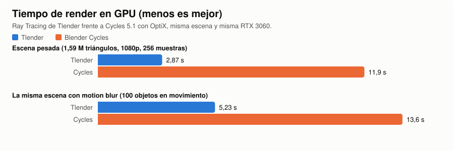

# Tlender

[English](README.md) · [Português](README.pt.md) · **Español**

**Tlender es un programa 3D para modelar, animar y renderizar personajes y escenas**, escrito desde cero en C y Vulkan
para ser rápido. Usa los mismos atajos, menús y conceptos que Blender, así que quien ya usa Blender se siente en casa, y
abre y guarda archivos `.blend`.

**Versión actual: 0.25** (13/11/2026) · Windows 10/11 64 bits · Español, English, Português ·
[Tlender Mobile para Android](https://github.com/NathanLourencoPeixoto/tlender-mobile-releases)

## Qué estás descargando

La [release más reciente](https://github.com/NathanLourencoPeixoto/tlender-releases/releases/latest) tiene tres archivos:

| Archivo | Qué es |
|---|---|
| `Tlender-<versión>-win64.zip` | **El programa.** Extrae la carpeta donde quieras y abre `tlender.exe` (no hay que instalar nada). |
| `Tlender-<versión>-win64.zip.sha256` | El código para comprobar que la descarga llegó completa. |
| `Tlender-<versión>-win64.zip.sig` | La firma que el actualizador de Tlender comprueba antes de instalar una versión nueva. |

Dentro del zip vienen `tlender.exe`, el instalador de actualizaciones (`tlender_updater.exe`), el denoiser (Intel OIDN),
NVIDIA DLSS, el runtime de Visual C++ y un `LEIA-ME.txt` (léeme). No se instala nada en el sistema; las preferencias se
guardan en `%APPDATA%\Tlender`. El idioma de la interfaz se cambia en *Editar > Preferencias > Interfaz > Traducción*.

**Requisitos**: una tarjeta gráfica con Vulkan 1.2. Para renderizar en la GPU hace falta ray tracing por hardware (NVIDIA
RTX, AMD RX 6000 o más nueva, Intel Arc); sin eso el render usa la CPU.

**Aviso de Windows**: el ejecutable todavía no tiene un certificado de firma de código, así que SmartScreen o el
antivirus pueden avisar la primera vez. Haz clic en *Más información → Ejecutar de todas formas*. Cada paquete está
firmado por el autor (el archivo `.sig`), y el actualizador solo instala versiones con esa firma.

## Actualizaciones

Tlender busca una versión nueva al abrirse y descarga **solo los archivos que cambiaron**. La versión nueva se instala
cuando cierras el programa. Marcando *Usar la versión Beta de Tlender* en las Preferencias entras en el **canal Beta** y
recibes antes las versiones de prueba (terminan en `_b`). Todo lo que cambió en cada versión está en las
[releases](https://github.com/NathanLourencoPeixoto/tlender-releases/releases) y en el propio programa (*Ayuda > Notas
de la versión*).

### Novedades de la 0.25

- **Modelado renovado**: una sola barra por categorías (Extruir y crear, Recortar, Aristas y bordes, Deformar, Limpiar
  y unir), consejos que explican cómo usar cada herramienta y el menú circular de modelado (Shift+Q).
- **Herramientas nuevas**: Multi-Cut, Connect, Smart Extrude, Cerrar agujero, Coser borde, Soldar al objetivo, Press
  Pull y un bevel que se puede editar después de hecho.
- **Animación por etapas**: barras para Bloquear, Spline y Pulir, cambio de espacio sin saltos, fijar en el mundo,
  dibujo 2D sobre la vista, editor de fantasmas, rastreador de arcos y gráfico de espaciado.
- **Iconos nuevos** en dos tonos, con el elemento afectado en naranja.

## Más rápido que Blender

Medido en la misma máquina, con el mismo archivo en los dos programas (Blender 5.1):

## Fiel a Blender

El objetivo es el mismo resultado que da Blender, con el mismo archivo:

| Qué se comparó | Resultado |
|---|---|
| Luces (sol, foco y área) frente a Cycles | sol y foco idénticos; luz de área a menos del 0,1% |
| Archivos glTF exportados, abiertos en 6 versiones de Blender (4.0 a 5.3) | 66 de 66 correctos |
| Archivos FBX exportados, abiertos en las mismas 6 versiones | 54 de 54 correctos (vértices con piel a 0,000005) |
| Drivers de un rig de producción importado desde `.blend` | 370 de 370 iguales |
| `.blend` | abre de Blender 2.7x a 5.3 y guarda para 4.0, 4.2, 4.5, 5.0, 5.1 o 5.3 |

## Lo que Tlender tiene y Blender no

- **Tres renderizadores**: *Ray Tracing* (path tracer como Cycles), *Render X* (más rápido con luz indirecta) y *Tiempo
  real*, con **DLSS** y Ray Reconstruction en los tres.
- **Posar arrastrando en cualquier rig**: reconoce Auto-Rig Pro, Rigify, AdvancedSkeleton, Mixamo, MetaHuman, VRoid,
  Character Creator, Daz y otros, y posa con los controles del propio rig.
- **Herramientas de animador**: etapas Bloquear/Spline/Pulir, espacios temporales, fijar en el mundo, dibujo 2D por
  fotograma, fantasmas, arcos, gráfico de espaciado y ayuda de física (centro de masa y trayectoria).
- **Lip sync en portugués**, rotoscopia con IA (SAM 2), multitudes y captura de movimiento en vivo.
- **Física**: líquidos y gases en vóxeles, fuego que ilumina la escena, telas, cuerdas y cadenas, cuerpos rígidos,
  destrucción, lluvia que moja y escurre, pelo con física.
- **Texture Graph** en vivo en los materiales, en 16 bits, animable y calculado en la GPU.
- **Modo Maya**: atajos, iconos, Hotbox y Attribute Editor para quien viene de Maya.
- **Exporta a Real Engine**, el motor de juegos del mismo autor.
- **Tlender Mobile**: el mismo programa en móviles y tabletas Android, con interfaz para tacto y lápiz.

## Reportar un problema

En el programa: *Ayuda > Reportar un error* (o el escarabajo de la barra de estado) o *Enviar sugerencia*. El texto, las
imágenes y el informe de fallo se envían directamente, sin necesidad de cuenta en GitHub.
