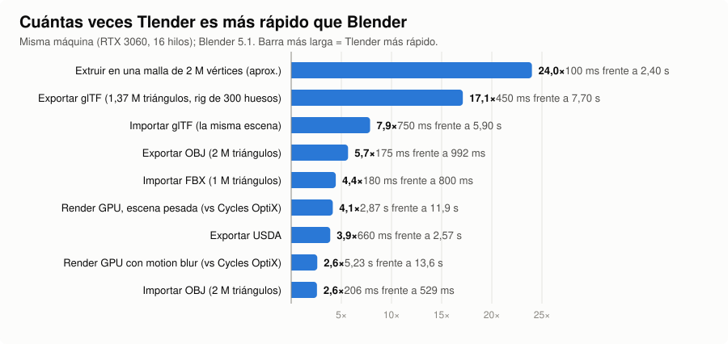

# Tlender

[English](README.md) · [Português](README.pt.md) · **Español**

**Tlender es un programa 3D para modelar, animar y renderizar personajes y escenas**, escrito desde cero en C y Vulkan
para ser rápido. Usa los mismos atajos, menús y conceptos que Blender, así que quien ya usa Blender se siente en casa, y
abre y guarda archivos `.blend`.

**Versión actual: 0.39** (21/11/2026) · Windows 10/11 64 bits · Español, English, Português ·
[Tlender Mobile para Android](https://github.com/NathanLourencoPeixoto/tlender-mobile-releases)

## Qué estás descargando

La [release más reciente](https://github.com/NathanLourencoPeixoto/tlender-releases/releases/latest) tiene tres archivos:

| Archivo | Qué es |
|---|---|
| `Tlender-<versión>-win64.zip` | **El programa.** Extrae la carpeta donde quieras y abre `tlender.exe` (no hay que instalar nada). |
| `Tlender-<versión>-win64.zip.sha256` | El código para comprobar que la descarga llegó completa. |
| `Tlender-<versión>-win64.zip.sig` | La firma que el actualizador de Tlender comprueba antes de instalar una versión nueva. |

Dentro del zip vienen `tlender.exe`, el instalador de actualizaciones (`tlender_updater.exe`), el denoiser (Intel OIDN),
NVIDIA DLSS, el runtime de Visual C++ y un `LEIA-ME.txt` (léeme). No se instala nada en el sistema; las preferencias se
guardan en `%APPDATA%\Tlender`. El idioma de la interfaz se cambia en *Editar > Preferencias > Interfaz > Traducción*.

**Requisitos**: una tarjeta gráfica con Vulkan 1.2. Para renderizar en la GPU hace falta ray tracing por hardware (NVIDIA
RTX, AMD RX 6000 o más nueva, Intel Arc); sin eso el render usa la CPU.

**Aviso de Windows**: el ejecutable todavía no tiene un certificado de firma de código, así que SmartScreen o el
antivirus pueden avisar la primera vez. Haz clic en *Más información → Ejecutar de todas formas*. Cada paquete está
firmado por el autor (el archivo `.sig`), y el actualizador solo instala versiones con esa firma.

## Actualizaciones

Tlender busca una versión nueva al abrirse y descarga **solo los archivos que cambiaron**. La versión nueva se instala
cuando cierras el programa. Marcando *Usar la versión Beta de Tlender* en las Preferencias entras en el **canal Beta** y
recibes antes las versiones de prueba (terminan en `_b`). Todo lo que cambió en cada versión está en las
[releases](https://github.com/NathanLourencoPeixoto/tlender-releases/releases) y en el propio programa (*Ayuda > Notas
de la versión*).

### Novedades de la 0.39 y de Mobile 0.21

- **Escenas pesadas rápidas**: un personaje lleno de modificadores con mocap grabado cuadro a cuadro se reproducía a 8
  cuadros por segundo y ahora a 33; guardar una escena de 1 millón de keys pasó de 3,3 s a 0,45 s y el autoguardado espera a
  que dejes de mover; el deshacer ya no copia todas las keys en cada paso.
- **G y R por la cámara y X/Y en el Graph Editor**, como en Blender: G mueve y R gira la cámara mirando por ella; G X / G Y
  y S X / S Y en el Graph Editor.
- **Mocap más limpio**: pies que no se deslizan en el Retarget (de 30–50 cm a unos 2 cm por paso), dedos correctos en rigs
  cuyas falanges copian un control, y la pelvis sin tirones (PC).

### Novedades de la 0.38 y de Mobile 0.20

- **Cara en personajes con partes**: un personaje con solo mandíbula, ojos y párpados en huesos (sin labios ni shape
  keys) recibe la cara del mocap en lo que tiene: la boca por la mandíbula, la mirada a los lados y arriba y abajo, los
  párpados parpadeando. Shape keys de expresión con ojos en huesos también.
- **Límites del rig en el Retarget**: Limit Rotation y Limit Location del personaje respetados en el Retarget, el
  horneado y la cara; los huesos de abajo compensan lo que el de arriba no pudo.
- **Solo cuerpo, Solo cara, Cuerpo y cara** (PC): en la pestaña Mocap, graba el cuerpo con una cámara y la cara de cerca
  con otra; el vídeo Solo cara da su cara al cuerpo del grupo, sincronizado por el sonido.

### Novedades de la 0.37 y de Mobile 0.19

- **Retarget en todos los auto-rigs**: Auto-Rig Pro, Rigify (el nuevo, el legado y el FBX), Mixamo, MetaHuman, el Mannequin de Unreal, Character Creator / iClone / AccuRIG, Daz Genesis 8 y 9, VRoid / VRM, HumanIK de Maya y los nombres del Humanoid de Unity, y rigs propios de estudio (los accesorios nunca son
  miembro). Manos y pies en **IK o FK**, cada miembro a su manera; un rig solo con IK va por el IK; **Configurar rig**
  para un rig propio, guardado en el perfil.
- **Cara modular**: expresiones propias (cara no humana), muchos a muchos, shape keys en portugués y la cara por un
  panel de sliders junto a la cabeza.
- **Física de los huesos** en la malla al reproducir (antes solo después del horneado), hueso con física animable en
  Modo Pose y el horneado en la acción de la línea de tiempo.
- Los vídeos fuera de la vista no se decodifican al reproducir (sin lag); el vídeo del mocap en el Image Editor.

### Corrección de la 0.36 y de Mobile 0.18

- La 0.35 se cerraba al abrir cuando la interfaz guardada tenía un editor Retarget. **Si su 0.35 se cierra al abrir**,
  descargue `Tlender-0.36-win64.zip` en la [release](https://github.com/NathanLourencoPeixoto/tlender-releases/releases/latest) y extráigalo encima de la carpeta de Tlender. Desde la
  0.36, una apertura que se cierra hace que la siguiente abra con las pestañas de fábrica y busque una actualización enseguida.

### Novedades de la 0.35 y de Mobile 0.17

- **La interfaz guardada, como en Blender** (PC y Mobile): cambiar pestañas y áreas ya no guarda solo; Guardar
  preferencias guarda la interfaz, y vuelve al abrir Tlender y en Archivo > Nuevo.
- **La pestaña Mocap sigue al archivo**: Archivo > Nuevo deja la pestaña vacía, cada .tlend tiene su lista de vídeos y
  cada vídeo tiene una papelera para quitarlo de la lista (y "Vaciar la lista").
- **Limpiar mapa en el Retarget** (PC y Mobile): quita el hueso de todos los papeles de un lado (Ctrl+Z lo deshace), y
  Limpiar todo en la cara; y el IK del personaje apagado por defecto (los miembros van en FK; "Usar el IK del rig" lo enciende).

### Novedades de la 0.34 y de Mobile 0.16

- **Mocap rehecho sobre RGB MoCap**, dentro de Tlender (usa los runtimes y modelos de su instalación de RGB MoCap): ExMR,
  FlowHMR o GVHMR, **varios vídeos** (persona nueva u otro ángulo, sincronizados solos), girar el vídeo, encontrar
  personas, barra con el tiempo restante, corrección de contactos editable, cara, exportar FBX/BVH, **muñeco 3D** y
  **root motion** (andando o en el sitio). En una toma de webcam + celular, el error del cuerpo en el mundo bajó de
  13,5 cm (RGB MoCap) a 9 cm con la webcam y 7,1 cm con los dos ángulos. PC con NVIDIA.
- **Retarget a cualquier personaje** (PC y Mobile), ahora un editor: siluetas de las partes del cuerpo, vista previa
  igual al horneado, "En el sitio", ajuste por hueso, la **cara** en shape keys o huesos/controles (cada expresión ligada
  a un objetivo) y **perfiles** guardados por rig. El cálculo es el de RGB MoCap: 1,4 cm de su resultado (antes 13 cm), y
  los rigs reales funcionan (Auto-Rig Pro, rigs de juego, piernas en IK con polo, rigs que estiran).
- **Importar el FBX de RGB MoCap**, con la cara ARKit/Live Link.

### Novedades de la 0.31

- **Mocap en tus personajes**: Aplicar prepara cualquier rig humano por sí solo (Auto-Rig Pro también), el personaje
  queda firme (sin temblar ni caminar por el mundo), la cara de rigs Auto-Rig Pro va por los controles, se detecta la
  lengua y el polish gana una capa propia sobre la capa del mocap, editable y con menos claves.
- **Sin giros del cuerpo** con una cámara, y los brazos ya no saltan entre cuadros; una pierna que aparece en medio de
  la imagen ahora se sigue.
- **Rastreo 3 veces más rápido** (video de 35 s: ~90 s -> ~30 s); los videos 4K se leen más de dos veces más rápido.
- **Verificar con Claude** (opcional, con tu clave de la API de Claude): cuadros clave verificados para saber hacia
  dónde mira el actor y qué aparece en el cuadro.
- **Webcam + celular**: los videos de celular en vertical entran en la posición correcta, dos cámaras sin sonido se
  sincronizan por el movimiento y la calibración funciona aunque una cámara no muestre los pies.
- **Pies en el piso sin saltitos**: la limpieza del mocap usa las ideas de contacto de RGBMocap, cada una medida antes:
  la altura de la cadera sigue una curva suave que deja los pies quietos en el piso (cadera que andaba 4,4 m parado de
  pie -> 2,8 m), los pies trabados entran y salen sin tirón y los saltos de verdad siguen siendo saltos.
- **Piernas fuera del cuadro ya no tiran**: con una cámara, la estimación 3D de un hueso solo cuenta cuando la red lo
  ve de verdad.
- **Cuerpo por FlowHMR (externo, PC con NVIDIA)**: el paso Rastrear puede usar FlowHMR, un modelo temporal de cuerpo
  entero que tiembla mucho menos que las redes cuadro a cuadro, en un entorno Python tuyo (`tools/flowhmr_setup.ps1`).

### También nuevo desde la 0.29 (primero en la beta 0.30_b)

- **Mocap con vídeos de verdad**: lo que no aparece en el vídeo (las piernas en una webcam, un brazo que sale del cuadro)
  se queda quieto en lugar de agitarse: pose T si nunca aparece, la última pose vista hasta 2 s, y una vuelta suave. Los
  vídeos de torso y brazos ahora rastrean el cuerpo y la cara.
- **Vista previa 3D de la cara** en el paso Rastrear: una cabeza con las 52 expresiones ARKit movida por el rastreo, y la
  malla de la cara (ojos, iris, labios, contorno) dibujada sobre el vídeo.

### Novedades de la 0.29

- **Mocap por video**: la pestaña Mocap lleva del video a la animación en 6 pasos (Fuentes, Sincronizar, Calibrar,
  Rastrear, Limpiar, Aplicar). Cuerpo, manos y cara, juntos o por separado, por videos, webcam, celular (se vuelve cámara
  por Wi-Fi con un código QR) o varias cámaras y un dron a la vez, sincronizados y calibrados solos.
- **En cualquier personaje**: el esqueleto listo "Mocap Tlender" o el rig de su personaje (Mixamo, Unreal, CC, auto-rig,
  Rigify); la cara en shape keys, huesos reales, rigs mixtos o rigs con controles.
- **Exportar al Real Engine (.tlend)** con las mallas evaluadas y los nodos horneados en imágenes.
- Selección por caja como en Blender (cualquier parte visible del objeto), texturas que se actualizan solas cuando el
  archivo cambia y apertura más rápida (~7 s -> 2,4 s).

### Novedades de la 0.28

- **Sin esperar los kernels de la GPU**: F12 y la vista Renderizada muestran la imagen casi al instante (34,8 s -> 0,6 s
  en la escena de prueba) mientras el kernel completo termina en segundo plano, y cambian a él sin pantalla negra.
- **Kernels guardados uno a uno**: la segunda apertura tiene todo listo en 0,3 s; después de una actualización solo se
  recompila lo que cambió; una barra de progreso real que dice lo que falta.
- **Tiempo real compila más rápido** (solo los grupos de nodos que usa la escena: 128 s -> 56 s).
- Se retiraron los portales entre escenas; las varias escenas, las View Layers y la escena dentro de escena se
  mantienen.

## Capturas

## Más rápido que Blender

Medido en la misma máquina, con el mismo archivo en los dos programas (Blender 5.1):

## Fiel a Blender

El objetivo es el mismo resultado que da Blender, con el mismo archivo:

| Qué se comparó | Resultado |
|---|---|
| Luces (sol, foco y área) frente a Cycles | sol y foco idénticos; luz de área a menos del 0,1% |
| Archivos glTF exportados, abiertos en 6 versiones de Blender (4.0 a 5.3) | 66 de 66 correctos |
| Archivos FBX exportados, abiertos en las mismas 6 versiones | 54 de 54 correctos (vértices con piel a 0,000005) |
| Drivers de un rig de producción importado desde `.blend` | 370 de 370 iguales |
| `.blend` | abre de Blender 2.7x a 5.3 y guarda para 4.0, 4.2, 4.5, 5.0, 5.1 o 5.3 |

## Lo que Tlender tiene y Blender no

- **Tres renderizadores**: *Ray Tracing* (path tracer como Cycles), *Render X* (más rápido con luz indirecta) y *Tiempo
  real*, con **DLSS** y Ray Reconstruction en los tres.
- **Posar arrastrando en cualquier rig**: reconoce Auto-Rig Pro, Rigify, AdvancedSkeleton, Mixamo, MetaHuman, VRoid,
  Character Creator, Daz y otros, y posa con los controles del propio rig.
- **Herramientas de animador**: etapas Bloquear/Spline/Pulir, espacios temporales, fijar en el mundo, dibujo 2D por
  fotograma, fantasmas, arcos, gráfico de espaciado y ayuda de física (centro de masa y trayectoria).
- **Lip sync en portugués**, rotoscopia con IA (SAM 2), multitudes y captura de movimiento en vivo.
- **Física**: líquidos y gases en vóxeles, fuego que ilumina la escena, telas, cuerdas y cadenas, cuerpos rígidos,
  destrucción, lluvia que moja y escurre, pelo con física.
- **Texture Graph** en vivo en los materiales, en 16 bits, animable y calculado en la GPU.
- **Modo Maya**: atajos, iconos, Hotbox y Attribute Editor para quien viene de Maya.
- **Exporta a Real Engine**, el motor de juegos del mismo autor.
- **Tlender Mobile**: el mismo programa en móviles y tabletas Android, con interfaz para tacto y lápiz.

## Reportar un problema

En el programa: *Ayuda > Reportar un error* (o el escarabajo de la barra de estado) o *Enviar sugerencia*. El texto, las
imágenes y el informe de fallo se envían directamente, sin necesidad de cuenta en GitHub.
