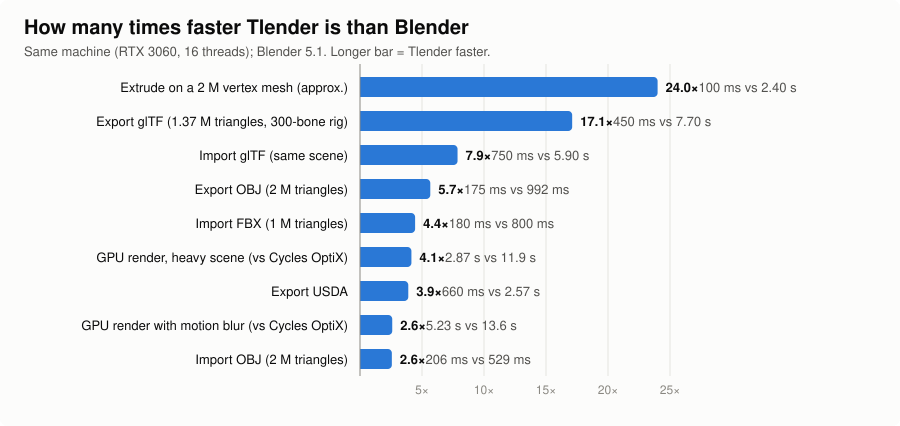

# Tlender

**English** · [Português](README.pt.md) · [Español](README.es.md)

**Tlender is a 3D app for modeling, animating and rendering characters and scenes**, written from scratch in C and
Vulkan to be fast. It uses the same shortcuts, menus and concepts as Blender, so Blender users feel at home, and it
opens and saves `.blend` files.

**Current version: 0.28** (2026-11-14) · Windows 10/11 64-bit · English, Português, Español ·
[Tlender Mobile for Android](https://github.com/NathanLourencoPeixoto/tlender-mobile-releases)

## What you are downloading

The [latest release](https://github.com/NathanLourencoPeixoto/tlender-releases/releases/latest) has three files:

| File | What it is |
|---|---|
| `Tlender-<version>-win64.zip` | **The program.** Extract the folder anywhere and open `tlender.exe` (nothing to install). |
| `Tlender-<version>-win64.zip.sha256` | The checksum to confirm the download arrived intact. |
| `Tlender-<version>-win64.zip.sig` | The signature Tlender's updater checks before installing a new version. |

The zip contains `tlender.exe`, the update installer (`tlender_updater.exe`), the denoiser (Intel OIDN), NVIDIA DLSS,
the Visual C++ runtime and a `LEIA-ME.txt` (readme). Nothing is installed on the system; preferences are kept in
`%APPDATA%\Tlender`. The interface language is set in *Edit > Preferences > Interface > Translation*.

**Requirements**: a graphics card with Vulkan 1.2. Rendering on the GPU needs hardware ray tracing (NVIDIA RTX, AMD RX
6000 or newer, Intel Arc); without it, rendering uses the CPU.

**Windows warning**: the executable does not have a code-signing certificate yet, so SmartScreen or your antivirus may
warn you the first time. Click *More info → Run anyway*. Every package is signed by the author (the `.sig` file), and
the updater only installs versions that carry that signature.

## Updates

Tlender checks for a new version when it opens and downloads **only the files that changed**. The new version is
installed when you close the program. Tick *Use Tlender Beta Version* in the Preferences to join the **Beta channel**
and get test versions first (they end in `_b`). Everything that changed in each version is in the
[releases](https://github.com/NathanLourencoPeixoto/tlender-releases/releases) and in the program itself (*Help >
Release Notes*).

### What's new in 0.28

- **No more waiting for GPU kernels**: F12 and the Rendered view show the image almost at once (34.8 s -> 0.6 s in the
  test scene) while the full kernel finishes in the background, and switch to it with no black screen.
- **Kernels kept one by one**: the second launch has everything ready in 0.3 s; after an update only what changed
  recompiles; a real progress bar that says what is left.
- **Realtime compiles faster** (only the node groups the scene uses: 128 s -> 56 s).
- The portals between scenes were removed; several scenes, View Layers and scene-in-scene stay.

## Screenshots

## Faster than Blender

Measured on the same machine, with the same file in both programs (Blender 5.1):

## Faithful to Blender

The goal is the same result Blender gives, from the same file:

| What was compared | Result |
|---|---|
| Lights (sun, spot and area) against Cycles | sun and spot identical; area light within 0.1% |
| Exported glTF files opened in 6 Blender versions (4.0 to 5.3) | 66 of 66 correct |
| Exported FBX files opened in the same 6 versions | 54 of 54 correct (skinned vertices within 0.000005) |
| Drivers of a production rig imported from `.blend` | 370 of 370 identical |
| `.blend` | opens Blender 2.7x to 5.3 files and saves for 4.0, 4.2, 4.5, 5.0, 5.1 or 5.3 |

## What Tlender has that Blender doesn't

- **Three renderers**: *Ray Tracing* (a path tracer like Cycles), *Render X* (faster with indirect light) and
  *Realtime*, with **DLSS** and Ray Reconstruction in all three.
- **Drag posing on any rig**: recognizes Auto-Rig Pro, Rigify, AdvancedSkeleton, Mixamo, MetaHuman, VRoid, Character
  Creator, Daz and more, and poses through the rig's own controls.
- **Animator tools**: Block/Spline/Polish stages, temporary spaces, world lock, per-frame 2D drawing, ghosts, arcs,
  spacing chart and physics help (center of mass and trajectory).
- **Portuguese lip sync**, AI rotoscoping (SAM 2), crowds and live motion capture.
- **Physics**: voxel liquids and gases, fire that lights the scene, cloth, ropes and chains, rigid bodies, destruction,
  rain that wets and drips, hair with physics.
- **Texture Graph** live in materials, in 16 bits, animatable and computed on the GPU.
- **Maya mode**: shortcuts, icons, Hotbox and Attribute Editor for people coming from Maya.
- **Exports to Real Engine**, the game engine by the same author.
- **Tlender Mobile**: the same program on Android phones and tablets, with an interface for touch and pen.

## Reporting a problem

In the program: *Help > Report a Bug* (or the bug icon in the status bar) or *Send a Suggestion*. The text, images and
crash report are sent directly, no GitHub account needed.
