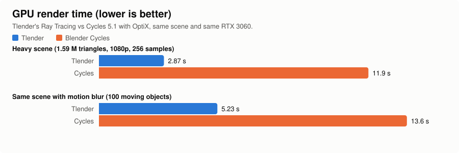

# Tlender

**English** · [Português](README.pt.md) · [Español](README.es.md)

**Tlender is a 3D app for modeling, animating and rendering characters and scenes**, written from scratch in C and
Vulkan to be fast. It uses the same shortcuts, menus and concepts as Blender, so Blender users feel at home, and it
opens and saves `.blend` files.

**Current version: 0.41** (2026-11-22) · Windows 10/11 64-bit · English, Português, Español ·
[Tlender Mobile for Android](https://github.com/NathanLourencoPeixoto/tlender-mobile-releases)

## What you are downloading

The [latest release](https://github.com/NathanLourencoPeixoto/tlender-releases/releases/latest) has three files:

| File | What it is |
|---|---|
| `Tlender-<version>-win64.zip` | **The program.** Extract the folder anywhere and open `tlender.exe` (nothing to install). |
| `Tlender-<version>-win64.zip.sha256` | The checksum to confirm the download arrived intact. |
| `Tlender-<version>-win64.zip.sig` | The signature Tlender's updater checks before installing a new version. |

The zip contains `tlender.exe`, the update installer (`tlender_updater.exe`), the denoiser (Intel OIDN), NVIDIA DLSS,
the Visual C++ runtime and a `LEIA-ME.txt` (readme). Nothing is installed on the system; preferences are kept in
`%APPDATA%\Tlender`. The interface language is set in *Edit > Preferences > Interface > Translation*.

**Requirements**: a graphics card with Vulkan 1.2. Rendering on the GPU needs hardware ray tracing (NVIDIA RTX, AMD RX
6000 or newer, Intel Arc); without it, rendering uses the CPU.

**Windows warning**: the executable does not have a code-signing certificate yet, so SmartScreen or your antivirus may
warn you the first time. Click *More info → Run anyway*. Every package is signed by the author (the `.sig` file), and
the updater only installs versions that carry that signature.

## Updates

Tlender checks for a new version when it opens and downloads **only the files that changed**. The new version is
installed when you close the program. Tick *Use Tlender Beta Version* in the Preferences to join the **Beta channel**
and get test versions first (they end in `_b`). Everything that changed in each version is in the
[releases](https://github.com/NathanLourencoPeixoto/tlender-releases/releases) and in the program itself (*Help >
Release Notes*).

### What's new in 0.41 and Mobile 0.23

- **Characters full of modifiers play back much faster**: with Mirror, Armature, Delta Mush, Subdivision, Solidify and
  Displace over the skeleton, an animation frame went from 134 ms to 9 ms (from 7 to over 100 frames per second); the
  deformers only move the vertices instead of copying the whole mesh, and the result is the same.
- **Scenes with thousands of separate objects**: 10,000 objects play at 37 frames per second (4 before); the viewport no
  longer draws what is outside the frame and the Outliner went from 60 ms to under 1 ms a frame.

### What's new in 0.40 and Mobile 0.22

- **Third-party rigs that match Blender**: 14 of NovaBandit's 15 FNAF 2 animatronics now move exactly as in Blender
  (4 before): parts on the pistons, wires, eyes driven through a curve, two IKs on one arm; Bezier handles follow the
  current Blender rule on every animation curve.
- **Wires that drag during playback**: on rigs with wire "physics" the wire trails behind the hand while playing, and
  settles when stopped.
- **The Retarget recognizes many more characters**: Valorant agents, FNAF 1 and FNAF 2 humans, Mario, Woody, Kissy Missy,
  Huggy, BoxyBoo and more (56 of 254 rigs surveyed got better); five rigs that closed the program on opening now open.

### What's new in 0.39 and Mobile 0.21

- **Fast heavy scenes**: a character full of modifiers with a mocap baked frame by frame played at 8 frames per second and
  now plays at 33; saving a scene of 1 million keys went from 3.3 s to 0.45 s and autosave waits for you to stop moving;
  undo no longer copies every key on each step.
- **G and R through the camera and X/Y in the Graph Editor**, like Blender: G moves and R rolls the camera while looking
  through it; G X / G Y and S X / S Y in the Graph Editor.
- **Cleaner mocap**: feet that don't slide in the Retarget (from 30–50 cm to about 2 cm a step), correct fingers on rigs
  whose joints copy a control, and a pelvis without flicks (PC).

### What's new in 0.38 and Mobile 0.20

- **Face on characters with parts**: a character with only a jaw, eyes and eyelids as bones (no lips or shape keys) gets
  the mocap face on what it has: the mouth through the jaw, the eyes looking left, right, up and down, the eyelids
  blinking. Expression shape keys with eyes on bones too.
- **Rig limits in the Retarget**: the character's Limit Rotation and Limit Location kept in the Retarget, the bake and the
  face; the bones below make up for what the one above could not do.
- **Body only, Face only, Body and face** (PC): in the Mocap tab, record the body with one camera and the face up close
  with another; the Face only video gives its face to the group's body, synced by sound.

### What's new in 0.37 and Mobile 0.19

- **Retarget on every auto-rig**: Auto-Rig Pro, Rigify (new, legacy and FBX), Mixamo, MetaHuman, the Unreal Mannequin, Character Creator / iClone / AccuRIG, Daz Genesis 8 and 9, VRoid / VRM, Maya's HumanIK and Unity's Humanoid names, and studio rigs of their own (accessories never become a
  limb). Hands and feet in **IK or FK**, each limb its own way; a rig with only IK goes through the IK; **Configure Rig**
  for an own rig, saved in the profile.
- **Modular face**: own expressions (a non-human face), many to many, Portuguese shape keys and the face through a
  slider panel beside the head.
- **Bone physics** on the mesh while playing (before only after the bake), a bone with physics animatable in Pose Mode
  and the bake into the timeline's action.
- Videos out of sight are not decoded while playing (no lag); the mocap's video in the Image Editor.

### Fix of 0.36 and Mobile 0.18

- 0.35 closed on start when the saved interface had a Retarget editor. **If your 0.35 closes on start**, download
  `Tlender-0.36-win64.zip` from the [release](https://github.com/NathanLourencoPeixoto/tlender-releases/releases/latest) and extract it over the Tlender folder. From 0.36 on, a start
  that closes makes the next one open with the factory tabs and check for an update at once.

### What's new in 0.35 and Mobile 0.17

- **The saved interface, as in Blender** (PC and Mobile): changing tabs and areas no longer saves by itself; Save
  Preferences keeps the interface, and it comes back when Tlender opens and on File > New.
- **The Mocap tab follows the file**: File > New leaves the tab empty, each .tlend has its own video list and each video
  has a trash button to take it off the list (plus "Clear the List").
- **Clear Map in the Retarget** (PC and Mobile): takes the bone off every role of a side (Ctrl+Z undoes it), and Clear
  All on the face; and the character's IK off by default (the limbs go in FK; "Use the Rig's IK" turns it on).

### What's new in 0.34 and Mobile 0.16

- **Mocap rebuilt on RGB MoCap**, inside Tlender (using the runtimes and models of your RGB MoCap installation): ExMR,
  FlowHMR or GVHMR, **several videos** (new person or another angle, synced by themselves), turning the video, finding
  people, a bar with the time left, editable contact correction, face, FBX/BVH export, a **3D figure** and **root
  motion** (travelling or in place). On a webcam + phone take, the body's world error fell from 13.5 cm (RGB MoCap) to
  9 cm with the webcam and 7.1 cm with both angles. PC with NVIDIA.
- **Retarget to any character** (PC and Mobile), now an editor: body-part silhouettes, a preview equal to the bake,
  "In place", per-bone offsets, the **face** on shape keys or bones/controls (each expression linked to a target) and
  **profiles** saved per rig. The math is RGB MoCap's: 1.4 cm from its result (13 cm before), and real rigs work
  (Auto-Rig Pro, game rigs, IK legs with a pole, stretching rigs).
- **Import RGB MoCap's FBX**, with the ARKit/Live Link face.

### What's new in 0.31

- **Mocap on your own characters**: Apply prepares any human rig by itself (Auto-Rig Pro included), the character holds
  steady (no shaking, no wandering), Auto-Rig Pro faces go through their controls, the tongue is detected, and the
  polish gets its own layer over an editable mocap layer with fewer keys.
- **No more body spins** with one camera, and the arms no longer pop between frames; a leg that shows in the middle of
  the picture is followed.
- **Tracking 3 times faster** (a 35-second video: ~90 s -> ~30 s); 4K videos read more than twice as fast.
- **Check with Claude** (optional, your Claude API key): key frames checked for which way the actor faces and what
  the frame shows.
- **Webcam + phone**: portrait phone videos come in upright, two cameras without sound sync by movement, and the
  calibration works even when one camera does not show the feet.
- **Feet on the floor without hops**: the mocap cleanup uses RGBMocap's contact ideas, each measured first: the hips'
  height follows a smooth curve that keeps still feet down (hips wandering 4.4 m while standing -> 2.8 m), locked feet
  ease in and out without a jolt, and real jumps stay jumps.
- **Legs out of the frame no longer pull**: with one camera, the 3D guess of a bone only counts when the network really
  sees it.
- **Body by FlowHMR (external, PC with NVIDIA)**: the Track step can use FlowHMR, a whole-body temporal model that
  shakes much less than frame-by-frame networks, run in your own Python environment (`tools/flowhmr_setup.ps1`).

### Also new since 0.29 (first in beta 0.30_b)

- **Mocap with real videos**: what the video doesn't show (the legs on a webcam, an arm leaving the frame) stays still
  instead of thrashing: T-pose if it never shows, the last pose seen for up to 2 s, and a smooth way back. Upper-body
  videos now track both the body and the face.
- **3D face preview** in the Track step: a head with the 52 ARKit expressions driven by the tracking, and the face mesh
  (eyes, irises, lips, outline) drawn over the video.

### What's new in 0.29

- **Video mocap**: the Mocap tab goes from video to animation in 6 steps (Sources, Sync, Calibrate, Track, Clean,
  Apply). Body, hands and face, together or on their own, from videos, the webcam, the phone (it becomes a camera over
  Wi-Fi with a QR code) or several cameras and a drone at once, synced and calibrated automatically.
- **Onto any character**: the ready skeleton "Mocap Tlender" or your character's rig (Mixamo, Unreal, CC, auto-rig,
  Rigify); the face onto shape keys, real bones, mixed rigs or rigs with controls.
- **Export to the Real Engine (.tlend)** with the evaluated meshes and the nodes baked into images.
- Box select like Blender's (any visible part of the object), textures that update by themselves when the file changes
  and faster startup (~7 s -> 2.4 s).

### What's new in 0.28

- **No more waiting for GPU kernels**: F12 and the Rendered view show the image almost at once (34.8 s -> 0.6 s in the
  test scene) while the full kernel finishes in the background, and switch to it with no black screen.
- **Kernels kept one by one**: the second launch has everything ready in 0.3 s; after an update only what changed
  recompiles; a real progress bar that says what is left.
- **Realtime compiles faster** (only the node groups the scene uses: 128 s -> 56 s).
- The portals between scenes were removed; several scenes, View Layers and scene-in-scene stay.

## Screenshots

## Faster than Blender

Measured on the same machine, with the same file in both programs (Blender 5.1):

## Faithful to Blender

The goal is the same result Blender gives, from the same file:

| What was compared | Result |
|---|---|
| Lights (sun, spot and area) against Cycles | sun and spot identical; area light within 0.1% |
| Exported glTF files opened in 6 Blender versions (4.0 to 5.3) | 66 of 66 correct |
| Exported FBX files opened in the same 6 versions | 54 of 54 correct (skinned vertices within 0.000005) |
| Drivers of a production rig imported from `.blend` | 370 of 370 identical |
| `.blend` | opens Blender 2.7x to 5.3 files and saves for 4.0, 4.2, 4.5, 5.0, 5.1 or 5.3 |

## What Tlender has that Blender doesn't

- **Three renderers**: *Ray Tracing* (a path tracer like Cycles), *Render X* (faster with indirect light) and
  *Realtime*, with **DLSS** and Ray Reconstruction in all three.
- **Drag posing on any rig**: recognizes Auto-Rig Pro, Rigify, AdvancedSkeleton, Mixamo, MetaHuman, VRoid, Character
  Creator, Daz and more, and poses through the rig's own controls.
- **Animator tools**: Block/Spline/Polish stages, temporary spaces, world lock, per-frame 2D drawing, ghosts, arcs,
  spacing chart and physics help (center of mass and trajectory).
- **Portuguese lip sync**, AI rotoscoping (SAM 2), crowds and live motion capture.
- **Physics**: voxel liquids and gases, fire that lights the scene, cloth, ropes and chains, rigid bodies, destruction,
  rain that wets and drips, hair with physics.
- **Texture Graph** live in materials, in 16 bits, animatable and computed on the GPU.
- **Maya mode**: shortcuts, icons, Hotbox and Attribute Editor for people coming from Maya.
- **Exports to Real Engine**, the game engine by the same author.
- **Tlender Mobile**: the same program on Android phones and tablets, with an interface for touch and pen.

## Reporting a problem

In the program: *Help > Report a Bug* (or the bug icon in the status bar) or *Send a Suggestion*. The text, images and
crash report are sent directly, no GitHub account needed.
