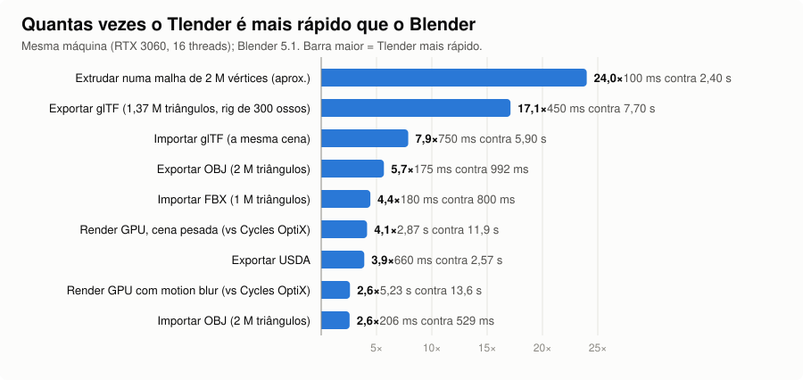
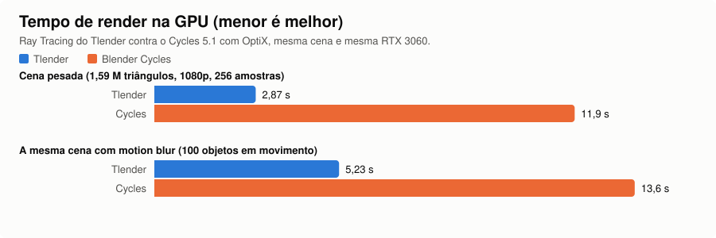

# Tlender

**Tlender é um programa de 3D para modelar, animar e renderizar personagens e cenas**, feito do zero em C e Vulkan para
ser rápido. Ele usa os mesmos atalhos, menus e conceitos do Blender, então quem já usa o Blender se sente em casa, e abre
e salva arquivos `.blend`.

> *English: Tlender is a fast 3D app for modeling, animation and rendering, written from scratch in C + Vulkan. It
> follows Blender's keymap and concepts and opens and saves `.blend` files. The interface is available in Portuguese,
> English and Spanish.*

**Versão atual: 0.25** (13/11/2026) · Windows 10/11 64 bits · Português, English, Español ·
[Tlender Mobile para Android](https://github.com/NathanLourencoPeixoto/tlender-mobile-releases)

## O que você está baixando

Na [release mais recente](https://github.com/NathanLourencoPeixoto/tlender-releases/releases/latest) há três arquivos:

| Arquivo | O que é |
|---|---|
| `Tlender-<versão>-win64.zip` | **O programa.** Extraia a pasta onde quiser e abra o `tlender.exe` (não precisa instalar nada). |
| `Tlender-<versão>-win64.zip.sha256` | O código para conferir se o download chegou inteiro. |
| `Tlender-<versão>-win64.zip.sig` | A assinatura que o atualizador do Tlender confere antes de instalar uma versão nova. |

Dentro do zip vêm o `tlender.exe`, o instalador de atualizações (`tlender_updater.exe`), o denoiser (Intel OIDN), o
NVIDIA DLSS, o runtime do Visual C++ e um `LEIA-ME.txt`. Nada é instalado no sistema; as preferências ficam em
`%APPDATA%\Tlender`.

**Requisitos**: uma placa de vídeo com Vulkan 1.2. Para renderizar na GPU, ray tracing por hardware (NVIDIA RTX, AMD RX
6000 ou mais nova, Intel Arc); sem isso o render usa a CPU.

**Aviso do Windows**: o executável ainda não tem um certificado de assinatura de código, então o SmartScreen ou o
antivírus podem alertar na primeira vez. Clique em *Mais informações → Executar assim mesmo*. Cada pacote é assinado
pelo autor (o arquivo `.sig`), e o atualizador só instala versões com essa assinatura.

## Atualizações

O Tlender procura uma versão nova ao abrir e baixa **só os arquivos que mudaram**. A versão nova é instalada quando você
fecha o programa. Marcando *Usar a versão Beta do Tlender* nas Preferências você entra no **canal Beta** e recebe as versões de teste antes (elas
terminam em `_b`). Tudo o que mudou em cada versão está nas [releases](https://github.com/NathanLourencoPeixoto/tlender-releases/releases)
e no próprio programa (*Ajuda > Notas da versão*).

### Novidades da 0.25

- **Modelagem revista**: uma barra só por categorias (Extrudar e criar, Cortar, Arestas e bordas, Deformar, Limpar e
  juntar), dicas que explicam como usar cada ferramenta e a pizza de modelagem (Shift+Q).
- **Ferramentas novas**: Multi-Cut, Connect, Smart Extrude, Fechar furo, Costurar borda, Solda no alvo, Press Pull e
  bevel editável depois de feito.
- **Animação por etapa**: barras para Bloquear, Spline e Polir, troca de espaço sem pulo, travar no mundo, desenho 2D
  sobre a vista, editor de fantasmas, rastreador de arcos e gráfico de espaçamento.
- **Ícones novos** em dois tons, com o elemento afetado em laranja.

## Mais rápido que o Blender

Medido na mesma máquina, com o mesmo arquivo nos dois programas (Blender 5.1):

## Fiel ao Blender

A meta é o mesmo resultado que o Blender dá, com o mesmo arquivo:

| O que foi comparado | Resultado |
|---|---|
| Luzes (sol, spot e área) contra o Cycles | sol e spot iguais; luz de área a menos de 0,1% |
| Arquivos glTF exportados, abertos em 6 versões do Blender (4.0 a 5.3) | 66 de 66 corretos |
| Arquivos FBX exportados, abertos nas mesmas 6 versões | 54 de 54 corretos (vértices com pele a 0,000005) |
| Drivers de uma rig de produção importada do `.blend` | 370 de 370 iguais |
| `.blend` | abre do Blender 2.7x ao 5.3 e salva para 4.0, 4.2, 4.5, 5.0, 5.1 ou 5.3 |

## O que o Tlender tem que o Blender não tem

- **Três renderizadores**: *Ray Tracing* (path tracer como o Cycles), *Render X* (mais rápido em luz indireta) e *Tempo
  real*, com **DLSS** e Ray Reconstruction nos três.
- **Pose por arrasto em qualquer rig**: reconhece Auto-Rig Pro, Rigify, AdvancedSkeleton, Mixamo, MetaHuman, VRoid,
  Character Creator, Daz e outros, e posa pelos controles da própria rig.
- **Ferramentas de animador**: etapas Bloquear/Spline/Polir, espaços temporários, travar no mundo, desenho 2D por
  quadro, fantasmas, arcos, gráfico de espaçamento e ajuda de física (centro de massa e parábola).
- **Lip sync em português**, rotoscopia com IA (SAM 2), multidões e captura de movimento ao vivo.
- **Física**: líquidos e gases em voxels, fogo que ilumina a cena, tecidos, cordas e correntes, corpos rígidos,
  destruição, chuva que molha e escorre, hair com física.
- **Texture Graph** ao vivo nos materiais, em 16 bits, animável e calculado na GPU.
- **Modo Maya**: atalhos, ícones, Hotbox e Attribute Editor para quem vem do Maya.
- **Exporta para a Real Engine**, a game engine do mesmo autor.
- **Tlender Mobile**: o mesmo programa em celulares e tablets Android, com interface para toque e caneta.

## Reportar um problema

No programa: *Ajuda > Reportar um bug* (ou o besouro na barra de status) ou *Enviar sugestão*. O texto, as imagens e
o relatório de travamento são enviados direto, sem precisar de conta no GitHub.
