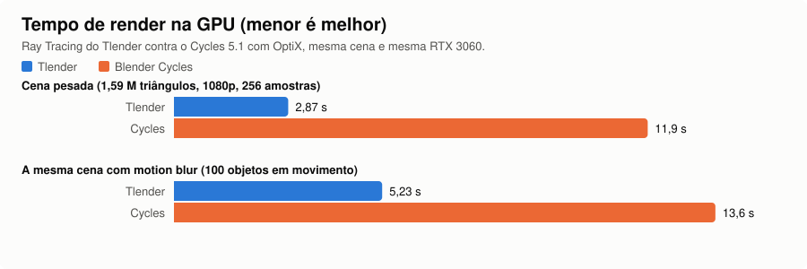

# Tlender

[English](README.md) · **Português** · [Español](README.es.md)

**Tlender é um programa de 3D para modelar, animar e renderizar personagens e cenas**, feito do zero em C e Vulkan para
ser rápido. Ele usa os mesmos atalhos, menus e conceitos do Blender, então quem já usa o Blender se sente em casa, e abre
e salva arquivos `.blend`.

**Versão atual: 0.31** (20/11/2026) · Beta: **0.32_b** (20/11/2026) · Windows 10/11 64 bits · Português, English, Español ·
[Tlender Mobile para Android](https://github.com/NathanLourencoPeixoto/tlender-mobile-releases)

## O que você está baixando

Na [release mais recente](https://github.com/NathanLourencoPeixoto/tlender-releases/releases/latest) há três arquivos:

| Arquivo | O que é |
|---|---|
| `Tlender-<versão>-win64.zip` | **O programa.** Extraia a pasta onde quiser e abra o `tlender.exe` (não precisa instalar nada). |
| `Tlender-<versão>-win64.zip.sha256` | O código para conferir se o download chegou inteiro. |
| `Tlender-<versão>-win64.zip.sig` | A assinatura que o atualizador do Tlender confere antes de instalar uma versão nova. |

Dentro do zip vêm o `tlender.exe`, o instalador de atualizações (`tlender_updater.exe`), o denoiser (Intel OIDN), o
NVIDIA DLSS, o runtime do Visual C++ e um `LEIA-ME.txt`. Nada é instalado no sistema; as preferências ficam em
`%APPDATA%\Tlender`.

**Requisitos**: uma placa de vídeo com Vulkan 1.2. Para renderizar na GPU, ray tracing por hardware (NVIDIA RTX, AMD RX
6000 ou mais nova, Intel Arc); sem isso o render usa a CPU.

**Aviso do Windows**: o executável ainda não tem um certificado de assinatura de código, então o SmartScreen ou o
antivírus podem alertar na primeira vez. Clique em *Mais informações → Executar assim mesmo*. Cada pacote é assinado
pelo autor (o arquivo `.sig`), e o atualizador só instala versões com essa assinatura.

## Atualizações

O Tlender procura uma versão nova ao abrir e baixa **só os arquivos que mudaram**. A versão nova é instalada quando você
fecha o programa. Marcando *Usar a versão Beta do Tlender* nas Preferências você entra no **canal Beta** e recebe as versões de teste antes (elas
terminam em `_b`). Tudo o que mudou em cada versão está nas [releases](https://github.com/NathanLourencoPeixoto/tlender-releases/releases)
e no próprio programa (*Ajuda > Notas da versão*).

### Novidades da 0.32_b (Beta)

- **O RGB MoCap como motor do mocap**: com o RGB MoCap instalado, a aba Mocap roda o FlowHMR ou o ExMR dele num vídeo de
  uma câmera (Preferências > IA > FlowHMR = a pasta dele). PC com placa NVIDIA.
- **Corpo recolocado pela imagem**: os modelos acertam a pose, mas o corpo deriva no mundo; o Tlender acha a câmera pela
  imagem e recoloca o corpo em cada quadro. Num vídeo de webcam medido contra duas câmeras, o erro do corpo caiu de
  16 cm (FlowHMR do RGB MoCap) para 9 cm, com a mesma pose e sem tremer mais.

### Novidades da 0.31

- **Mocap nos seus personagens**: o Aplicar prepara qualquer rig humano sozinho (Auto-Rig Pro também), o personagem
  fica firme (sem tremer nem andar pelo mundo), o rosto de rigs Auto-Rig Pro vai pelos controles, a língua é detectada
  e o polish ganha uma camada própria sobre a camada do mocap, editável e com menos chaves.
- **Sem giros do corpo** com uma câmera, e os braços não estalam mais entre os quadros; uma perna que aparece no meio
  da imagem passa a ser seguida.
- **Rastreio 3 vezes mais rápido** (vídeo de 35 s: ~90 s -> ~30 s); vídeos 4K leem mais de duas vezes mais rápido.
- **Conferir com o Claude** (opcional, com a sua chave da API do Claude): quadros-chave conferidos para saber para
  onde o ator está virado e o que aparece no quadro.
- **Webcam + celular**: vídeos de celular em pé entram na posição certa, duas câmeras sem som sincronizam pelo
  movimento e a calibração funciona mesmo quando uma câmera não mostra os pés.
- **Pés no chão sem pulos**: a limpeza do mocap usa as ideias de contato do RGBMocap, cada uma medida antes: a altura
  do quadril segue uma curva suave que põe os pés parados no chão (quadril que andava 4,4 m parado em pé -> 2,8 m), os
  pés travados entram e saem sem tranco e saltos de verdade continuam saltos.
- **Pernas fora do quadro não puxam mais**: com uma câmera, o palpite 3D de um osso só conta quando a rede o vê de
  verdade.
- **Corpo pelo FlowHMR (externo, PC com NVIDIA)**: o passo Rastrear pode usar o FlowHMR, um modelo temporal de corpo
  inteiro que treme bem menos que as redes de quadro em quadro, rodando num ambiente Python seu
  (`tools/flowhmr_setup.ps1`).

### Também novo desde a 0.29 (primeiro na beta 0.30_b)

- **Mocap com vídeos de verdade**: o que não aparece no vídeo (as pernas numa webcam, um braço que sai do quadro) fica
  parado em vez de se debater: T-pose se nunca aparece, a última pose vista por até 2 s, e volta suave. Vídeo de tronco e
  braços agora rastreia o corpo e o rosto.
- **Prévia 3D do rosto** no passo Rastrear: uma cabeça com as 52 expressões ARKit animada pelo rastreio, e a malha do
  rosto (olhos, íris, lábios, contorno) desenhada sobre o vídeo.

### Novidades da 0.29

- **Mocap por vídeo**: a aba Mocap leva do vídeo à animação em 6 passos (Fontes, Sincronizar, Calibrar, Rastrear,
  Limpar, Aplicar). Corpo, mãos e rosto, juntos ou separados, por vídeos, webcam, celular (vira câmera pelo Wi-Fi com um
  QR code) ou várias câmeras e um drone ao mesmo tempo, sincronizados e calibrados sozinhos.
- **Em qualquer personagem**: o esqueleto pronto "Mocap Tlender" ou o rig do seu personagem (Mixamo, Unreal, CC,
  auto-rig, Rigify); o rosto em shape keys, ossos reais, rigs mistos ou rigs com controles.
- **Exportar para a Real Engine (.tlend)** com as malhas avaliadas e os nós assados em imagens.
- Seleção por caixa como no Blender (qualquer parte visível do objeto), texturas que se atualizam sozinhas quando o
  arquivo muda e abertura mais rápida (~7 s -> 2,4 s).

### Novidades da 0.28

- **Sem esperar os kernels da GPU**: o F12 e a vista Renderizada mostram a imagem quase na hora (34,8 s -> 0,6 s na cena
  de teste) enquanto o kernel completo termina em segundo plano, e trocam para ele sem tela preta.
- **Kernels guardados um por um**: a segunda abertura deixa tudo pronto em 0,3 s; depois de uma atualização só o que
  mudou recompila; barra de progresso de verdade, dizendo o que falta.
- **Tempo real compila mais rápido** (só os grupos de nodes que a cena usa: 128 s -> 56 s).
- Os portais entre cenas foram retirados; as várias cenas, as View Layers e a cena dentro de cena continuam.

## Capturas

## Mais rápido que o Blender

Medido na mesma máquina, com o mesmo arquivo nos dois programas (Blender 5.1):

## Fiel ao Blender

A meta é o mesmo resultado que o Blender dá, com o mesmo arquivo:

| O que foi comparado | Resultado |
|---|---|
| Luzes (sol, spot e área) contra o Cycles | sol e spot iguais; luz de área a menos de 0,1% |
| Arquivos glTF exportados, abertos em 6 versões do Blender (4.0 a 5.3) | 66 de 66 corretos |
| Arquivos FBX exportados, abertos nas mesmas 6 versões | 54 de 54 corretos (vértices com pele a 0,000005) |
| Drivers de uma rig de produção importada do `.blend` | 370 de 370 iguais |
| `.blend` | abre do Blender 2.7x ao 5.3 e salva para 4.0, 4.2, 4.5, 5.0, 5.1 ou 5.3 |

## O que o Tlender tem que o Blender não tem

- **Três renderizadores**: *Ray Tracing* (path tracer como o Cycles), *Render X* (mais rápido em luz indireta) e *Tempo
  real*, com **DLSS** e Ray Reconstruction nos três.
- **Pose por arrasto em qualquer rig**: reconhece Auto-Rig Pro, Rigify, AdvancedSkeleton, Mixamo, MetaHuman, VRoid,
  Character Creator, Daz e outros, e posa pelos controles da própria rig.
- **Ferramentas de animador**: etapas Bloquear/Spline/Polir, espaços temporários, travar no mundo, desenho 2D por
  quadro, fantasmas, arcos, gráfico de espaçamento e ajuda de física (centro de massa e parábola).
- **Lip sync em português**, rotoscopia com IA (SAM 2), multidões e captura de movimento ao vivo.
- **Física**: líquidos e gases em voxels, fogo que ilumina a cena, tecidos, cordas e correntes, corpos rígidos,
  destruição, chuva que molha e escorre, hair com física.
- **Texture Graph** ao vivo nos materiais, em 16 bits, animável e calculado na GPU.
- **Modo Maya**: atalhos, ícones, Hotbox e Attribute Editor para quem vem do Maya.
- **Exporta para a Real Engine**, a game engine do mesmo autor.
- **Tlender Mobile**: o mesmo programa em celulares e tablets Android, com interface para toque e caneta.

## Reportar um problema

No programa: *Ajuda > Reportar um bug* (ou o besouro na barra de status) ou *Enviar sugestão*. O texto, as imagens e
o relatório de travamento são enviados direto, sem precisar de conta no GitHub.
