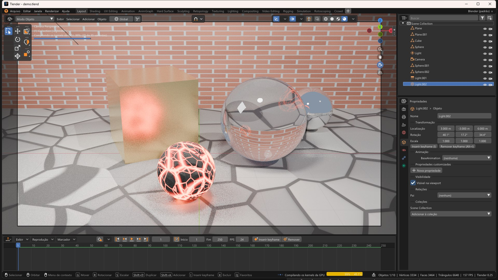
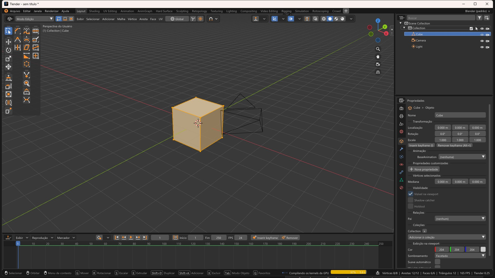
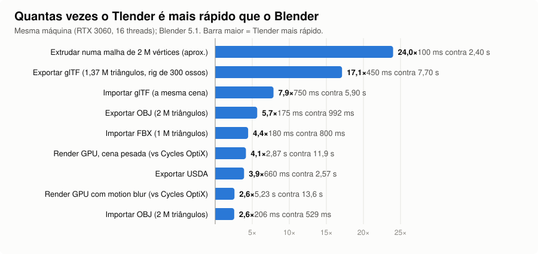

# Tlender

[English](README.md) · **Português** · [Español](README.es.md)

**Tlender é um programa de 3D para modelar, animar e renderizar personagens e cenas**, feito do zero em C e Vulkan para
ser rápido. Ele usa os mesmos atalhos, menus e conceitos do Blender, então quem já usa o Blender se sente em casa, e abre
e salva arquivos `.blend`.

**Versão atual: 0.44** (22/11/2026) · Windows 10/11 64 bits · Português, English, Español ·
[Tlender Mobile para Android](https://github.com/NathanLourencoPeixoto/tlender-mobile-releases)

## O que você está baixando

Na [release mais recente](https://github.com/NathanLourencoPeixoto/tlender-releases/releases/latest) há três arquivos:

| Arquivo | O que é |
|---|---|
| `Tlender-<versão>-win64.zip` | **O programa.** Extraia a pasta onde quiser e abra o `tlender.exe` (não precisa instalar nada). |
| `Tlender-<versão>-win64.zip.sha256` | O código para conferir se o download chegou inteiro. |
| `Tlender-<versão>-win64.zip.sig` | A assinatura que o atualizador do Tlender confere antes de instalar uma versão nova. |

Dentro do zip vêm o `tlender.exe`, o instalador de atualizações (`tlender_updater.exe`), o denoiser (Intel OIDN), o
NVIDIA DLSS, o runtime do Visual C++ e um `LEIA-ME.txt`. Nada é instalado no sistema; as preferências ficam em
`%APPDATA%\Tlender`.

**Requisitos**: uma placa de vídeo com Vulkan 1.2. Para renderizar na GPU, ray tracing por hardware (NVIDIA RTX, AMD RX
6000 ou mais nova, Intel Arc); sem isso o render usa a CPU.

**Aviso do Windows**: o executável ainda não tem um certificado de assinatura de código, então o SmartScreen ou o
antivírus podem alertar na primeira vez. Clique em *Mais informações → Executar assim mesmo*. Cada pacote é assinado
pelo autor (o arquivo `.sig`), e o atualizador só instala versões com essa assinatura.

## Atualizações

O Tlender procura uma versão nova ao abrir e baixa **só os arquivos que mudaram**. A versão nova é instalada quando você
fecha o programa. Marcando *Usar a versão Beta do Tlender* nas Preferências você entra no **canal Beta** e recebe as versões de teste antes (elas
terminam em `_b`). Tudo o que mudou em cada versão está nas [releases](https://github.com/NathanLourencoPeixoto/tlender-releases/releases)
e no próprio programa (*Ajuda > Notas da versão*).

### Novidades da 0.44 e do Mobile 0.26

- **G e R em ossos com Child Of** não fazem mais o osso pular para longe do mouse (a cabeça de um rig com troca de espaço).
- **Correntes da simulação de ossos assentam**: muitos ossos curtos com Dynamic Chain e Heavy Chain (fios, cabos) não
  giram mais sem parar; caem, param e balançam como chicote.
- **Editor de drivers**: o menu Adicionar variável não fecha mais o programa.

### Novidades da 0.43 e do Mobile 0.25

- **Câmera virtual pelo celular**: com o Tlender Mobile, girar e andar com o celular move a câmera que está filmando
  a cena do PC (seguindo os cortes do Ctrl+B), com a imagem da câmera na tela do celular e gravação de keys no play.
- **Render do Tempo real na melhor qualidade**: o F12 e o Ctrl+F12 usam sempre a malha inteira, as imagens inteiras e
  todos os quadros, sem limite de tempo; a malha dos personagens não pisca mais nas animações.
- **Playblast pelo Tempo real**: com a vista em Renderizado, o Playblast grava a imagem do Tempo real, com luzes, sombras
  e motion blur.
- **Play de personagens pesados de 36 para mais de 300 quadros por segundo**, sem travadinhas (normais em todos os núcleos,
  vídeos sem uso fora do play).
- **Sync to Audio no ritmo da cena** mesmo com o programa lento, e a **vista da câmera** não troca mais de câmera ao
  adicionar ou mover objetos (Ctrl+Numpad 0 escolhe a câmera da cena).

### Novidades da 0.42 e do Mobile 0.24

- **Arquivos dentro do .tlend**: *Arquivo > Dados externos > Empacotar recursos* guarda texturas, sons, vídeos, volumes e
  fontes dentro do arquivo, que abre em outro computador sem as pastas; desempacotar com as opções do Blender.
- **Caminhos relativos (`//`)**: o que está dentro da pasta do projeto é gravado como `//pasta/arquivo`, então dá para
  mover ou mandar a pasta inteira.
- **Procura inteligente de arquivos faltando**: ao abrir uma cena com texturas, sons ou vídeos que não estão no
  computador, o Tlender procura sozinho pelo conteúdo (mesmo renomeados), pelas pastas do projeto, pelo nome, por outra
  extensão e por nomes parecidos, e troca todos com um clique.
- **Aviso de "Salvo"** depois do Ctrl+S e **arquivos do Blender 2.79** (camadas, grupos e materiais do Blender Internal).

### Novidades da 0.41 e do Mobile 0.23

- **Personagens cheios de modificadores tocam muito mais rápido**: com Mirror, Armature, Delta Mush, Subdivisão, Solidify e
  Displace sobre o esqueleto, o quadro da animação caiu de 134 ms para 9 ms (de 7 para mais de 100 quadros por segundo);
  os deformadores movem só os vértices, sem copiar a malha inteira, e o resultado é o mesmo.
- **Cenas com milhares de objetos separados**: 10 mil objetos tocam a 37 quadros por segundo (antes 4); a viewport não
  desenha o que está fora do enquadramento e o Outliner caiu de 60 ms para menos de 1 ms por quadro.

### Novidades da 0.40 e do Mobile 0.22

- **Rigs de terceiros iguais ao Blender**: 14 dos 15 animatrônicos do FNAF 2 da NovaBandit agora se movem exatamente como
  no Blender (antes 4): peças nos pistões, fios, olhos com driver por curva, duas IK no mesmo braço; as alças Bezier
  seguem a regra do Blender atual em toda curva de animação.
- **Fios que arrastam no play**: nos rigs com "física" de fios, o fio fica para trás da mão tocando e assenta parado.
- **O Retarget reconhece muito mais personagens**: agentes do Valorant, FNAF 1 e humanos do FNAF 2, Mario, Woody, Kissy
  Missy, Huggy, BoxyBoo e outros (56 de 254 rigs testados melhoraram); cinco rigs que fechavam o programa ao abrir agora
  abrem.

### Novidades da 0.39 e do Mobile 0.21

- **Cenas pesadas rápidas**: um personagem cheio de modificadores com mocap gravado quadro a quadro tocava a 8 quadros por
  segundo e agora toca a 33; salvar uma cena de 1 milhão de keys caiu de 3,3 s para 0,45 s e o autossalvamento espera
  você parar de mexer; o desfazer não copia mais todas as keys a cada passo.
- **G e R pela câmera e X/Y no Graph Editor**, como no Blender: G move e R gira a câmera olhando por ela; G X / G Y e S X /
  S Y no Graph Editor.
- **Mocap mais limpo**: pés que não deslizam no Retarget (de 30–50 cm para cerca de 2 cm por passo), dedos certos em rigs
  com falanges que copiam um controle, e a pelve sem trancos (PC).

### Novidades da 0.38 e do Mobile 0.20

- **Rosto em personagens com partes**: personagem só com mandíbula, olhos e pálpebras em ossos (sem lábios nem shape
  keys) recebe o rosto do mocap no que tem: a boca pela mandíbula, o olhar para os lados e para cima e para baixo, as
  pálpebras piscando. Shape keys de expressão com olhos por osso também.
- **Limites do rig no Retarget**: Limit Rotation e Limit Location do personagem respeitados no Retarget, no bake e no
  rosto; os ossos de baixo compensam o que o de cima não pôde.
- **Só corpo, Só rosto, Corpo e rosto** (PC): na aba Mocap, grave o corpo numa câmera e o rosto de perto em outra; o vídeo
  Só rosto dá o rosto ao corpo do grupo, sincronizado pelo som.

### Novidades da 0.37 e do Mobile 0.19

- **Retarget em todos os auto-rigs**: Auto-Rig Pro, Rigify (o novo, o legado e o FBX), Mixamo, MetaHuman, o Mannequin da Unreal, Character Creator / iClone / AccuRIG, Daz Genesis 8 e 9, VRoid / VRM, HumanIK do Maya e os nomes do Humanoid da Unity, e rigs próprios de estúdio (acessórios nunca viram
  membro). Mãos e pés em **IK ou FK**, cada membro do seu jeito; rig só com IK vai pelo IK; **Configurar rig** para rig
  próprio, salvo no perfil.
- **Rosto modular**: expressões próprias (rosto não humano), muitos para muitos, shape keys em português e o rosto por
  um painel de sliders ao lado da cabeça.
- **Física dos ossos** na malha ao tocar (antes só depois do bake), osso com física animável em Modo Pose e o bake na
  ação da timeline.
- Vídeos fora da vista não decodificam com o play (sem lag); o vídeo do mocap no Image Editor.

### Correção da 0.36 e do Mobile 0.18

- A 0.35 fechava ao abrir quando a interface salva tinha um editor Retarget. **Se a sua 0.35 fecha ao abrir**, baixe o
  `Tlender-0.36-win64.zip` na [release](https://github.com/NathanLourencoPeixoto/tlender-releases/releases/latest) e extraia por cima da pasta do Tlender. A partir da 0.36, uma abertura
  que fecha faz a próxima abrir com as abas de fábrica e procurar atualização na hora.

### Novidades da 0.35 e do Mobile 0.17

- **A interface salva, como no Blender** (PC e Mobile): mudar abas e áreas não grava sozinho; Salvar preferências guarda
  a interface, e ela volta ao abrir o Tlender e em Arquivo > Novo.
- **A aba Mocap acompanha o arquivo**: Arquivo > Novo deixa a aba vazia, cada .tlend tem a sua lista de vídeos e cada
  vídeo tem uma lixeira para tirar da lista (mais "Limpar a lista").
- **Limpar mapa no Retarget** (PC e Mobile): tira o osso de todos os papéis de um lado (Ctrl+Z desfaz), e Limpar tudo no
  rosto; e o IK do personagem desligado por padrão (os membros vão em FK; "Usar o IK do rig" liga).

### Novidades da 0.34 e do Mobile 0.16

- **Mocap refeito sobre o RGB MoCap**, dentro do Tlender (usa os runtimes e modelos da sua instalação dele): ExMR,
  FlowHMR ou GVHMR, **vários vídeos** (pessoa nova ou outro ângulo, sincronizados sozinhos), girar o vídeo, achar
  pessoas, barra com o tempo restante, correção de contatos editável, rosto, exportar FBX/BVH, **boneco 3D** e **root
  motion** (andando ou no lugar). Num take de webcam + celular, o erro do corpo no mundo caiu de 13,5 cm (o RGB MoCap)
  para 9 cm com a webcam e 7,1 cm com os dois ângulos. PC com NVIDIA.
- **Retarget para qualquer personagem** (PC e Mobile), agora um editor: silhuetas das partes do corpo, prévia igual ao
  assado, "No lugar", ajuste por osso, o **rosto** em shape keys ou ossos/controles (cada expressão ligada a um alvo) e
  **perfis** salvos por rig. A conta é a do RGB MoCap: 1,4 cm do resultado dele (antes 13 cm), e rigs de verdade
  funcionam (Auto-Rig Pro, rigs de jogo, pernas em IK com polo, rigs que esticam).
- **Importar o FBX do RGB MoCap**, com o rosto ARKit/Live Link.

### Novidades da 0.31

- **Mocap nos seus personagens**: o Aplicar prepara qualquer rig humano sozinho (Auto-Rig Pro também), o personagem
  fica firme (sem tremer nem andar pelo mundo), o rosto de rigs Auto-Rig Pro vai pelos controles, a língua é detectada
  e o polish ganha uma camada própria sobre a camada do mocap, editável e com menos chaves.
- **Sem giros do corpo** com uma câmera, e os braços não estalam mais entre os quadros; uma perna que aparece no meio
  da imagem passa a ser seguida.
- **Rastreio 3 vezes mais rápido** (vídeo de 35 s: ~90 s -> ~30 s); vídeos 4K leem mais de duas vezes mais rápido.
- **Conferir com o Claude** (opcional, com a sua chave da API do Claude): quadros-chave conferidos para saber para
  onde o ator está virado e o que aparece no quadro.
- **Webcam + celular**: vídeos de celular em pé entram na posição certa, duas câmeras sem som sincronizam pelo
  movimento e a calibração funciona mesmo quando uma câmera não mostra os pés.
- **Pés no chão sem pulos**: a limpeza do mocap usa as ideias de contato do RGBMocap, cada uma medida antes: a altura
  do quadril segue uma curva suave que põe os pés parados no chão (quadril que andava 4,4 m parado em pé -> 2,8 m), os
  pés travados entram e saem sem tranco e saltos de verdade continuam saltos.
- **Pernas fora do quadro não puxam mais**: com uma câmera, o palpite 3D de um osso só conta quando a rede o vê de
  verdade.
- **Corpo pelo FlowHMR (externo, PC com NVIDIA)**: o passo Rastrear pode usar o FlowHMR, um modelo temporal de corpo
  inteiro que treme bem menos que as redes de quadro em quadro, rodando num ambiente Python seu
  (`tools/flowhmr_setup.ps1`).

### Também novo desde a 0.29 (primeiro na beta 0.30_b)

- **Mocap com vídeos de verdade**: o que não aparece no vídeo (as pernas numa webcam, um braço que sai do quadro) fica
  parado em vez de se debater: T-pose se nunca aparece, a última pose vista por até 2 s, e volta suave. Vídeo de tronco e
  braços agora rastreia o corpo e o rosto.
- **Prévia 3D do rosto** no passo Rastrear: uma cabeça com as 52 expressões ARKit animada pelo rastreio, e a malha do
  rosto (olhos, íris, lábios, contorno) desenhada sobre o vídeo.

### Novidades da 0.29

- **Mocap por vídeo**: a aba Mocap leva do vídeo à animação em 6 passos (Fontes, Sincronizar, Calibrar, Rastrear,
  Limpar, Aplicar). Corpo, mãos e rosto, juntos ou separados, por vídeos, webcam, celular (vira câmera pelo Wi-Fi com um
  QR code) ou várias câmeras e um drone ao mesmo tempo, sincronizados e calibrados sozinhos.
- **Em qualquer personagem**: o esqueleto pronto "Mocap Tlender" ou o rig do seu personagem (Mixamo, Unreal, CC,
  auto-rig, Rigify); o rosto em shape keys, ossos reais, rigs mistos ou rigs com controles.
- **Exportar para a Real Engine (.tlend)** com as malhas avaliadas e os nós assados em imagens.
- Seleção por caixa como no Blender (qualquer parte visível do objeto), texturas que se atualizam sozinhas quando o
  arquivo muda e abertura mais rápida (~7 s -> 2,4 s).

### Novidades da 0.28

- **Sem esperar os kernels da GPU**: o F12 e a vista Renderizada mostram a imagem quase na hora (34,8 s -> 0,6 s na cena
  de teste) enquanto o kernel completo termina em segundo plano, e trocam para ele sem tela preta.
- **Kernels guardados um por um**: a segunda abertura deixa tudo pronto em 0,3 s; depois de uma atualização só o que
  mudou recompila; barra de progresso de verdade, dizendo o que falta.
- **Tempo real compila mais rápido** (só os grupos de nodes que a cena usa: 128 s -> 56 s).
- Os portais entre cenas foram retirados; as várias cenas, as View Layers e a cena dentro de cena continuam.

## Capturas

## Mais rápido que o Blender

Medido na mesma máquina, com o mesmo arquivo nos dois programas (Blender 5.1):

## Fiel ao Blender

A meta é o mesmo resultado que o Blender dá, com o mesmo arquivo:

| O que foi comparado | Resultado |
|---|---|
| Luzes (sol, spot e área) contra o Cycles | sol e spot iguais; luz de área a menos de 0,1% |
| Arquivos glTF exportados, abertos em 6 versões do Blender (4.0 a 5.3) | 66 de 66 corretos |
| Arquivos FBX exportados, abertos nas mesmas 6 versões | 54 de 54 corretos (vértices com pele a 0,000005) |
| Drivers de uma rig de produção importada do `.blend` | 370 de 370 iguais |
| `.blend` | abre do Blender 2.7x ao 5.3 e salva para 4.0, 4.2, 4.5, 5.0, 5.1 ou 5.3 |

## O que o Tlender tem que o Blender não tem

- **Três renderizadores**: *Ray Tracing* (path tracer como o Cycles), *Render X* (mais rápido em luz indireta) e *Tempo
  real*, com **DLSS** e Ray Reconstruction nos três.
- **Pose por arrasto em qualquer rig**: reconhece Auto-Rig Pro, Rigify, AdvancedSkeleton, Mixamo, MetaHuman, VRoid,
  Character Creator, Daz e outros, e posa pelos controles da própria rig.
- **Ferramentas de animador**: etapas Bloquear/Spline/Polir, espaços temporários, travar no mundo, desenho 2D por
  quadro, fantasmas, arcos, gráfico de espaçamento e ajuda de física (centro de massa e parábola).
- **Lip sync em português**, rotoscopia com IA (SAM 2), multidões e captura de movimento ao vivo.
- **Física**: líquidos e gases em voxels, fogo que ilumina a cena, tecidos, cordas e correntes, corpos rígidos,
  destruição, chuva que molha e escorre, hair com física.
- **Texture Graph** ao vivo nos materiais, em 16 bits, animável e calculado na GPU.
- **Modo Maya**: atalhos, ícones, Hotbox e Attribute Editor para quem vem do Maya.
- **Procura arquivos faltando pelo conteúdo**: acha a textura renomeada ou a pasta do projeto movida para outro disco.
- **Exporta para a Real Engine**, a game engine do mesmo autor.
- **Tlender Mobile**: o mesmo programa em celulares e tablets Android, com interface para toque e caneta.

## Reportar um problema

No programa: *Ajuda > Reportar um bug* (ou o besouro na barra de status) ou *Enviar sugestão*. O texto, as imagens e
o relatório de travamento são enviados direto, sem precisar de conta no GitHub.
